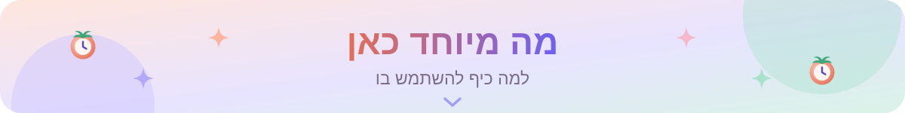
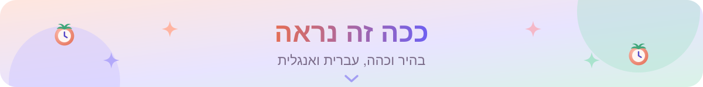
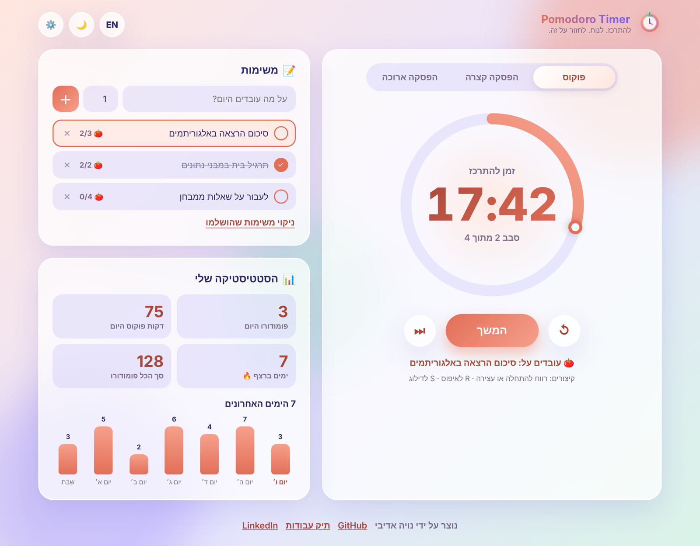
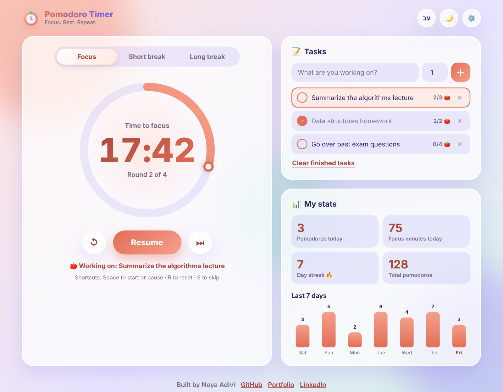
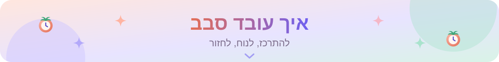
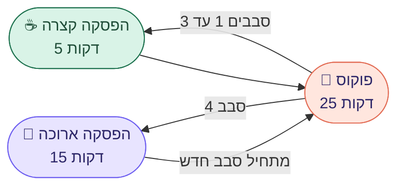

<div dir="rtl">

<p align="center">
  <a href="https://noyaadivi.github.io/pomodoro-timer/"></a>
</p>

<p align="center"><a href="README.md"></a></p>

<p align="center">
  <a href="https://noyaadivi.github.io/pomodoro-timer/"></a>
  <a href="app.js"></a>
  <a href="https://github.com/NoyaAdivi/pomodoro-timer/issues/new"></a>
</p>

<p align="center">
  <a href="LICENSE"></a>
  <a href="https://github.com/NoyaAdivi/pomodoro-timer/commits/main"></a>
  <a href="https://github.com/NoyaAdivi/pomodoro-timer/search?l=javascript"></a>
  <a href="https://github.com/NoyaAdivi/pomodoro-timer"></a>
</p>

<h3 align="center">להתרכז. לנוח. לחזור על זה. טיימר ללמידה שבאמת כיף להסתכל עליו.</h3>

<p align="center">
  טיימר פומודורו ב־<b>JavaScript נקי</b>, עם אנימציות חלקות, רשימת משימות, סטטיסטיקה יומית וגרף שבועי.<br>
  הכל נשמר ב־<b>localStorage</b>, כך שרענון של הדף אף פעם לא מוחק את הטיימר, המשימות או הרצף שלך.
</p>

<table align="center">
  <tr>
    <td align="center" width="25%"><a href="#how-a-cycle-works"><b>🍅 25 · 5 · 15</b></a><br><sub>פוקוס, הפסקה קצרה וארוכה</sub></td>
    <td align="center" width="25%"><a href="#saved-in-your-browser"><b>💾 0 שרתים</b></a><br><sub>כל המידע נשאר בדפדפן</sub></td>
    <td align="center" width="25%"><a href="#see-it-in-action"><b>🌍 HE · EN</b></a><br><sub>דו לשוני לגמרי, כולל RTL</sub></td>
    <td align="center" width="25%"><a href="#keyboard-shortcuts"><b>⌨️ 3 מקשים</b></a><br><sub>רווח, R ו־S</sub></td>
  </tr>
</table>

<a name="highlights"></a>
<p align="center"><a href="#see-it-in-action"></a></p>

<table dir="rtl">
  <tr valign="top">
    <td valign="top" width="33%">
      <p><b>⏱️ טיימר שאפשר לסמוך עליו</b></p>
      <ul>
        <li><b>טבעת התקדמות מונפשת</b> עם נקודה שזזה וזוהר רך שנושם</li>
        <li><b>זמן מדויק:</b> סופר לאחור מחותמת זמן של הסיום ולא ממונה, אז הוא לא זז</li>
        <li><b>שורד רענון:</b> סוגרים את הלשונית, חוזרים, והוא ממשיך מאיפה שהיה</li>
        <li><b>סבבים אוטומטיים:</b> הפסקה ארוכה אחרי כל 4 סבבי פוקוס (את בוחרת את המספר)</li>
      </ul>
    </td>
    <td valign="top" width="33%">
      <p><b>📝 משימות וסטטיסטיקה</b></p>
      <ul>
        <li><b>רשימת משימות</b> עם הערכה של כמה פומודורו כל משימה תיקח</li>
        <li><b>המשימה שנבחרה</b> מקבלת 🍅 אחרי כל סבב פוקוס ומסומנת כהושלמה כשמגיעים ליעד</li>
        <li><b>סטטיסטיקה יומית:</b> פומודורו, דקות פוקוס, סך הכל ורצף ימים 🔥</li>
        <li><b>גרף עמודות שבועי</b> של 7 הימים האחרונים, עם עמודות מונפשות</li>
      </ul>
    </td>
    <td valign="top" width="33%">
      <p><b>💖 נבנה באהבה</b></p>
      <ul>
        <li><b>עברית ואנגלית</b> בלחיצה אחת, כולל פריסת RTL מלאה</li>
        <li><b>מצב בהיר וכהה</b>, ולכל מצב בטיימר יש צבע פסטל משלו</li>
        <li><b>קונפטי</b>, צליל עדין (Web Audio, בלי קובצי סאונד) והתראות בדפדפן</li>
        <li><b>נגיש:</b> קיצורי מקלדת, תוויות ARIA ותמיכה בהפחתת תנועה</li>
      </ul>
    </td>
  </tr>
</table>

<a name="see-it-in-action"></a>
<p align="center"><a href="#how-a-cycle-works"></a></p>

<table dir="rtl">
  <tr>
    <td width="50%"><a href="https://noyaadivi.github.io/pomodoro-timer/"></a></td>
    <td width="50%"><a href="https://noyaadivi.github.io/pomodoro-timer/"></a></td>
  </tr>
  <tr>
    <td align="center"><sub>עברית · מצב בהיר</sub></td>
    <td align="center"><sub>English · מצב בהיר</sub></td>
  </tr>
</table>

<a name="how-a-cycle-works"></a>
<p align="center"><a href="#saved-in-your-browser"></a></p>



<p align="center"><sub>כל סבב פוקוס שמסתיים נשמר בסטטיסטיקה. את כל הזמנים, מספר הסבבים וההתחלה האוטומטית אפשר לשנות ב־⚙️ הגדרות.</sub></p>

<a name="saved-in-your-browser"></a>
<p align="center"><a href="#tech-stack"></a></p>

הכל נשמר תחת מפתח אחד, `pomodoro-timer.v1`, ב־`localStorage`:

| שדה | מה נשמר בו |
|---|---|
| `timer` | המצב הנוכחי, הסבב, הזמן שנשאר וחותמת הזמן של הסיום כשהטיימר רץ |
| `settings` | דקות לכל מצב, סבבים עד הפסקה ארוכה, התחלה אוטומטית, צליל והתראות |
| `tasks`, `activeTask` | המשימות, ההערכות וההתקדמות שלהן, והמשימה שנבחרה |
| `days`, `total` | פומודורו ודקות פוקוס לכל יום, וסך הכל מאז ומעולם |
| `lang`, `theme` | עברית או אנגלית, בהיר או כהה |

> [!TIP]
> אפשר לפתוח את הטיימר בשתי לשוניות: הן נשארות מסונכרנות בעזרת האירוע `storage`.

<a name="tech-stack"></a>
<p align="center"><a href="#run-locally"></a></p>

<p align="center"><b>בסיס</b><br>
<a href="https://developer.mozilla.org/docs/Web/HTML"></a>
<a href="https://developer.mozilla.org/docs/Web/CSS"></a>
<a href="https://developer.mozilla.org/docs/Web/JavaScript"></a>
</p>

<p align="center"><b>ממשקי דפדפן</b><br>
<a href="https://developer.mozilla.org/docs/Web/API/Window/localStorage"></a>
<a href="https://developer.mozilla.org/docs/Web/API/Web_Audio_API"></a>
<a href="https://developer.mozilla.org/docs/Web/API/Notifications_API"></a>
<a href="https://developer.mozilla.org/docs/Web/API/Intl"></a>
</p>

<p align="center"><b>העלאה לאוויר</b><br>
<a href="https://pages.github.com"></a>
</p>

<a name="keyboard-shortcuts"></a>
<details open>
<summary><b>⌨️ קיצורי מקלדת</b></summary>
<br>

| מקש | פעולה |
|---|---|
| <kbd>Space</kbd> | התחלה או עצירה |
| <kbd>R</kbd> | איפוס הטיימר הנוכחי |
| <kbd>S</kbd> | דילוג למצב הבא |

</details>

<a name="run-locally"></a>
<p align="center"><a href="#contact"></a></p>

1. מורידים את הפרויקט:
   ```bash
   git clone https://github.com/NoyaAdivi/pomodoro-timer.git
   ```
2. פותחים את `index.html` בדפדפן. זהו, אין מה להתקין.

<details>
<summary><b>📂 מבנה הפרויקט</b></summary>

```
├── index.html          הדף: טיימר, משימות, סטטיסטיקה וחלון ההגדרות
├── style.css           עיצוב פסטל, אנימציות, מצב כהה ו־RTL
├── app.js              לוגיקת הטיימר, localStorage, משימות, סטטיסטיקה, צליל ותרגומים
├── logo.svg            הלוגו והאייקון של הלשונית
└── docs/
    ├── images/         צילומי מסך ל־README
    └── readme/         באנרים וכותרות מונפשים
```
</details>

<a name="contact"></a>
<p align="center"><a href="https://www.linkedin.com/in/noya-adivi/"></a></p>

<p align="center">
  <a href="https://noyaadivi.github.io/pomodoro-timer/"></a>
  <a href="https://www.linkedin.com/in/noya-adivi/"></a>
  <a href="https://noyaadivi.github.io/noya-website"></a>
  <a href="https://github.com/NoyaAdivi"></a>
</p>

</div>
