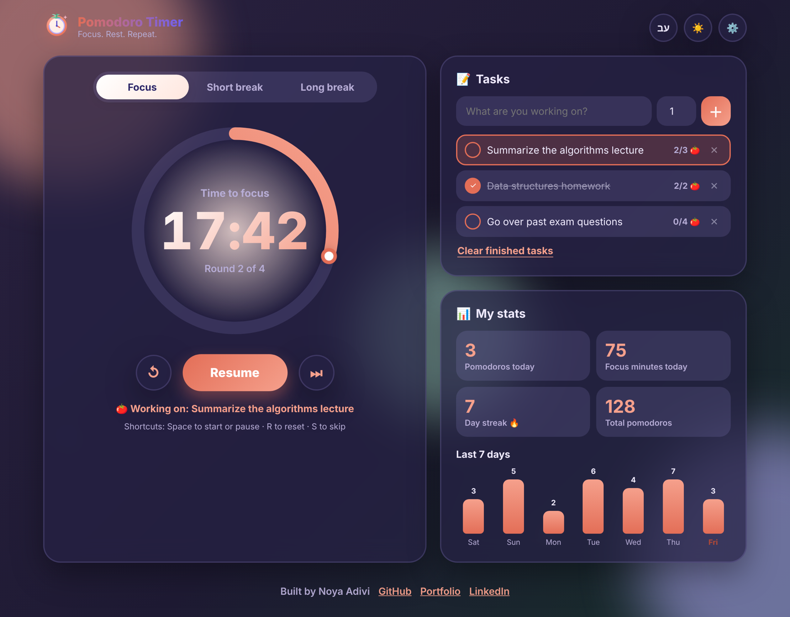
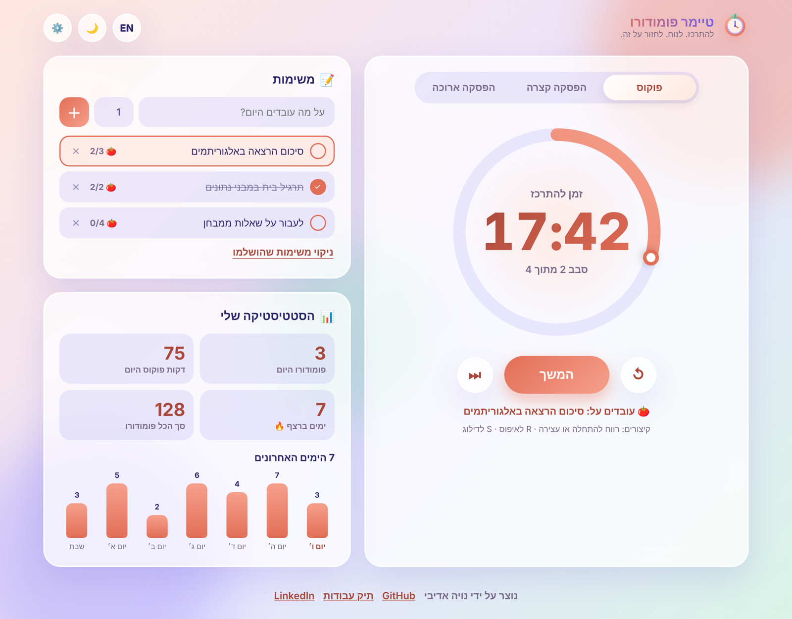
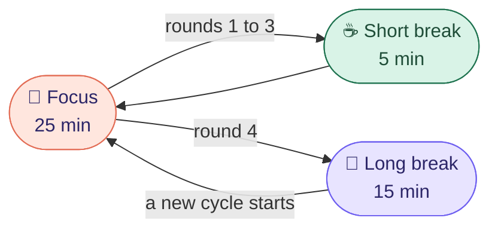
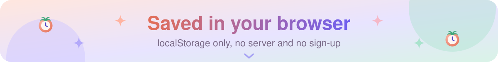
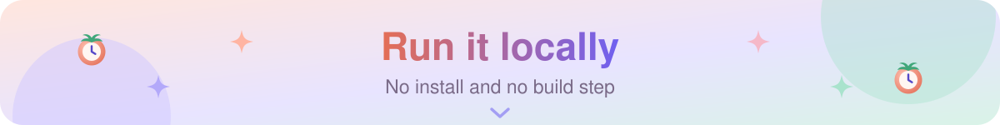

<p align="center">
  <a href="https://noyaadivi.github.io/pomodoro-timer/"></a>
</p>

<p align="center"><a href="README.he.md"></a></p>

<p align="center">
  <a href="https://noyaadivi.github.io/pomodoro-timer/"></a>
  <a href="app.js"></a>
  <a href="https://github.com/NoyaAdivi/pomodoro-timer/issues/new"></a>
</p>

<p align="center">
  <a href="LICENSE"></a>
  <a href="https://github.com/NoyaAdivi/pomodoro-timer/commits/main"></a>
  <a href="https://github.com/NoyaAdivi/pomodoro-timer/search?l=javascript"></a>
  <a href="https://github.com/NoyaAdivi/pomodoro-timer"></a>
</p>

<h3 align="center">Focus. Rest. Repeat. A study timer that is actually fun to look at.</h3>

<p align="center">
  A Pomodoro timer in <b>pure JavaScript</b>, with smooth animations, a task list, daily stats and a weekly chart.<br>
  Everything is saved in <b>localStorage</b>, so a refresh never loses your timer, your tasks or your streak.
</p>

<table align="center">
  <tr>
    <td align="center" width="25%"><a href="#how-a-cycle-works"><b>🍅 25 · 5 · 15</b></a><br><sub>focus, short and long break</sub></td>
    <td align="center" width="25%"><a href="#saved-in-your-browser"><b>💾 0 servers</b></a><br><sub>all data stays in your browser</sub></td>
    <td align="center" width="25%"><a href="#see-it-in-action"><b>🌍 HE · EN</b></a><br><sub>fully bilingual, RTL ready</sub></td>
    <td align="center" width="25%"><a href="#keyboard-shortcuts"><b>⌨️ 3 keys</b></a><br><sub>Space, R and S</sub></td>
  </tr>
</table>

<a name="highlights"></a>
<p align="center"><a href="#see-it-in-action"></a></p>

<table>
  <tr valign="top">
    <td valign="top" width="33%">
      <p><b>⏱️ A timer you can trust</b></p>
      <ul>
        <li><b>Animated progress ring</b> with a moving dot and a soft breathing glow</li>
        <li><b>Accurate time:</b> counts down from an end timestamp, not from a counter, so it never drifts</li>
        <li><b>Survives a refresh:</b> close the tab, come back, and it continues where it was</li>
        <li><b>Auto rounds:</b> a long break after every 4 focus sessions (you choose the number)</li>
      </ul>
    </td>
    <td valign="top" width="33%">
      <p><b>📝 Tasks and stats</b></p>
      <ul>
        <li><b>Task list</b> with a pomodoro estimate for every task</li>
        <li><b>The selected task</b> gets +1 🍅 after each focus session and is marked done at its goal</li>
        <li><b>Daily stats:</b> pomodoros, focus minutes, total and a 🔥 day streak</li>
        <li><b>Weekly bar chart</b> of the last 7 days, with animated bars</li>
      </ul>
    </td>
    <td valign="top" width="33%">
      <p><b>💖 Made with care</b></p>
      <ul>
        <li><b>Hebrew and English</b> with one click, including full RTL layout</li>
        <li><b>Light and dark mode</b>, and every mode has its own pastel color</li>
        <li><b>Confetti</b>, a soft chime (Web Audio, no sound files) and browser notifications</li>
        <li><b>Accessible:</b> keyboard shortcuts, ARIA labels and support for reduced motion</li>
      </ul>
    </td>
  </tr>
</table>

<a name="see-it-in-action"></a>
<p align="center"><a href="#how-a-cycle-works"></a></p>

<table>
  <tr>
    <td width="50%"><a href="https://noyaadivi.github.io/pomodoro-timer/"></a></td>
    <td width="50%"><a href="https://noyaadivi.github.io/pomodoro-timer/"></a></td>
  </tr>
  <tr>
    <td align="center"><sub>English · dark mode</sub></td>
    <td align="center"><sub>עברית · light mode</sub></td>
  </tr>
</table>

<a name="how-a-cycle-works"></a>
<p align="center"><a href="#saved-in-your-browser"></a></p>



<p align="center"><sub>Every finished focus session is saved to your stats. All the times, the number of rounds and auto start can be changed in ⚙️ Settings.</sub></p>

<a name="saved-in-your-browser"></a>
<p align="center"><a href="#tech-stack"></a></p>

Everything lives under one key, `pomodoro-timer.v1`, in `localStorage`:

| Field | What it keeps |
|---|---|
| `timer` | Current mode, round, time left and the end timestamp of a running timer |
| `settings` | Minutes for each mode, rounds until a long break, auto start, sound, notifications |
| `tasks`, `activeTask` | Your tasks, their estimates and progress, and the selected task |
| `days`, `total` | Pomodoros and focus minutes per day, and the all time total |
| `lang`, `theme` | Hebrew or English, light or dark |

> [!TIP]
> Open the timer in two tabs: they stay in sync through the `storage` event.

<a name="tech-stack"></a>
<p align="center"><a href="#run-locally"></a></p>

<p align="center"><b>Core</b><br>
<a href="https://developer.mozilla.org/docs/Web/HTML"></a>
<a href="https://developer.mozilla.org/docs/Web/CSS"></a>
<a href="https://developer.mozilla.org/docs/Web/JavaScript"></a>
</p>

<p align="center"><b>Browser APIs</b><br>
<a href="https://developer.mozilla.org/docs/Web/API/Window/localStorage"></a>
<a href="https://developer.mozilla.org/docs/Web/API/Web_Audio_API"></a>
<a href="https://developer.mozilla.org/docs/Web/API/Notifications_API"></a>
<a href="https://developer.mozilla.org/docs/Web/API/Intl"></a>
</p>

<p align="center"><b>Ship</b><br>
<a href="https://pages.github.com"></a>
</p>

<a name="keyboard-shortcuts"></a>
<details open>
<summary><b>⌨️ Keyboard shortcuts</b></summary>
<br>

| Key | Action |
|---|---|
| <kbd>Space</kbd> | Start or pause |
| <kbd>R</kbd> | Reset the current timer |
| <kbd>S</kbd> | Skip to the next mode |

</details>

<a name="run-locally"></a>
<p align="center"><a href="#contact"></a></p>

1. Clone the project:
   ```bash
   git clone https://github.com/NoyaAdivi/pomodoro-timer.git
   ```
2. Open `index.html` in your browser. That's it, there is nothing to install.

<details>
<summary><b>📂 Project structure</b></summary>

```
├── index.html          the page: timer, tasks, stats and the settings dialog
├── style.css           pastel theme, animations, dark mode and RTL
├── app.js              timer logic, localStorage, tasks, stats, sound and translations
├── logo.svg            the app logo and favicon
└── docs/
    ├── images/         screenshots for this README
    └── readme/         animated banners and section headers
```
</details>

<a name="contact"></a>
<p align="center"><a href="https://www.linkedin.com/in/noya-adivi/"></a></p>

<p align="center">
  <a href="https://noyaadivi.github.io/pomodoro-timer/"></a>
  <a href="https://www.linkedin.com/in/noya-adivi/"></a>
  <a href="https://noyaadivi.github.io/noya-website"></a>
  <a href="https://github.com/NoyaAdivi"></a>
</p>
